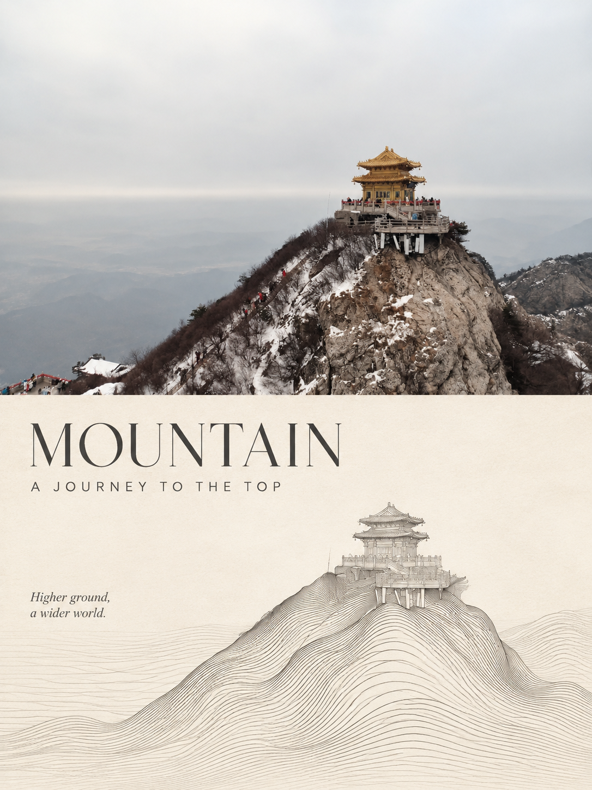
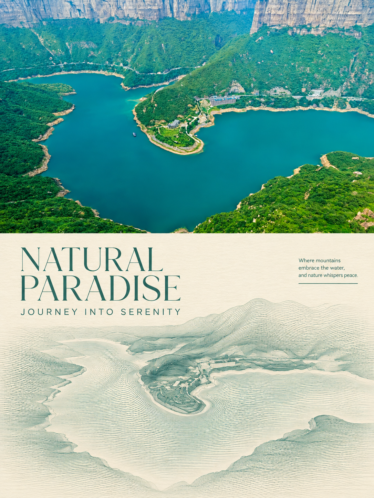
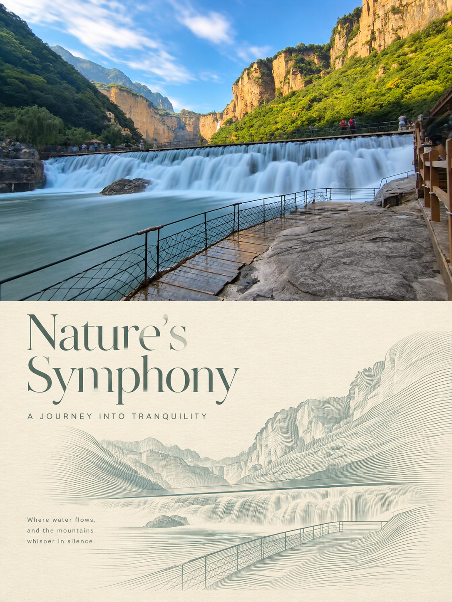

# Image Prompt · 图像重绘提示词集

> 一个用于分享「图像重绘 / 二次创作」提示词的公开仓库。每份提示词都配套实际生成效果图，方便直接复用与对比调试。

## 一、项目说明

本仓库收集并整理用于 **图像重绘（Image Redraw / 参考图二次创作）** 的中英文提示词。与常见的纯文字出图提示词不同，这里的提示词是**基于一张原始参考照片**进行结构化的二次创作：保留原图主体与构图，同时叠加统一的艺术版式与视觉语言。

目前收录的风格体系为 **「流体光栅雕塑美学」**——把原始照片的上半区原样保留，下半区将主体重构为细密平行的流体曲线雕塑，形成上下呼应的实验艺术双联海报。

### 目录结构

```
image-prompt/
├── Image/      # 生成效果预览图（PNG，3:4 竖幅）
└── Prompt/     # 提示词正文（Markdown，命名规则：日期 + 风格名称）
```

### 使用方法

1. 打开 `Prompt/` 下对应风格的 `.md` 文件，复制正文提示词（含末尾的负面提示词部分）。
2. 在支持图生图的模型 / 平台中上传一张**原始参考照片**。
3. 粘贴提示词，按需调整画面文字（标题 / 副标题）与主色调，比例固定选择 **3:4 竖幅**。
4. 首图效果不理想时，优先微调提示词中的「缩放与布局」「线条形态」段落，而非整体重写。

> 建议：同一张原图不要一次生成多稿拼接，提示词已明确要求「一图对应一稿」，保持单张出图才能保证版式与线条精度。

## 二、提示词与预览图对应表

| 编号 | 风格 / 主题 | 提示词文件 | 预览图 | 画面内容 |
| :--: | --- | --- | --- | --- |
| 001 | 流体光栅雕塑美学 | [20261109流体光栅雕塑美学.md](Prompt/20261109流体光栅雕塑美学.md) | [redraw-109.png](Image/redraw-109.png) | 雪岭之上的金顶古建 · MOUNTAIN |
| 002 | 流体光栅雕塑美学 | [20261109流体光栅雕塑美学.md](Prompt/20261109流体光栅雕塑美学.md) | [redraw-110.png](Image/redraw-110.png) | 峡谷环抱的碧色湖泊 · NATURAL PARADISE |
| 003 | 流体光栅雕塑美学 | [20261109流体光栅雕塑美学.md](Prompt/20261109流体光栅雕塑美学.md) | [redraw-111.png](Image/redraw-111.png) | 山间层叠的宽幅瀑布 · Nature's Symphony |

> 同一份提示词可适配不同类型原图（建筑 / 风景 / 静物 / 人物等），上表预览图仅展示其中三例。

### 效果预览

| 001 · MOUNTAIN | 002 · NATURAL PARADISE | 003 · Nature's Symphony |
| :--: | :--: | :--: |
|  |  |  |

## 三、免责声明

1. **来源说明**：本仓库中的提示词均为**网络公开渠道收集、整理与二次校订**，并非本人原创，原作者信息多数已不可考，故未逐一标注出处。
2. **版权归属**：提示词文本的著作权归原作者所有。若您是某份提示词的权利人且不希望其在本仓库中展示，请通过 Issue 或邮件联系，核实后将**立即删除**相关内容。
3. **使用范围**：本仓库内容仅供**个人学习、研究与交流**，请勿用于商业售卖、付费课程、二次打包分发等用途。因使用本仓库内容产生的任何版权纠纷或法律风险，由使用者自行承担。
4. **生成图像**：`Image/` 目录下的图片均为 AI 模型生成结果，仅用于展示提示词效果，**不代表**原图摄影师、出镜人物或原提示词作者的观点与授权。
5. **素材合规**：使用本仓库提示词进行创作时，请自行确保所上传的参考图拥有合法使用权，并遵守所在地区关于 AI 生成内容的法律法规与平台规则。

---

如果这些提示词对你有帮助，欢迎 Star ⭐ 支持一下。
